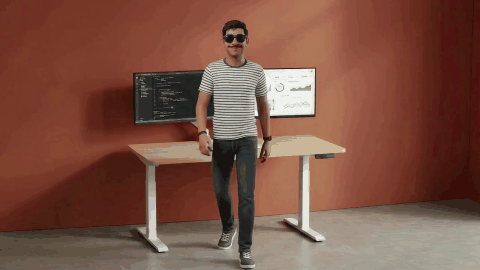

# 👋 Hi, I'm Mayank Singh Sadudia

### 📊 Data Analyst &bull; 🎨 Graphic Designer &bull; 🤖 Generative AI Creator
**Indore, Madhya Pradesh, India**

---

### 🎬 Meet Mayank — Continuous AI Presenter Introduction

  ⚡ <em>Click above to launch the full interactive 3D portfolio with HD audio commentary & controls.</em>

<video src="assets/Mayank_Continuous_AI_No_Gemini_Logo.mp4" controls="controls" width="100%" style="max-width: 620px; border-radius: 12px; margin-top: 8px;">
</video>

 

  
  &nbsp;&nbsp;
  

---

## 👨‍💻 About Me

I am a multidisciplinary professional bridging the gap between **analytical data intelligence** and **immersive visual design**. With hands-on experience spanning Python ETL pipelines, SQL relational modeling, BI dashboards, Adobe Creative Cloud, and Generative AI workflows, I transform complex data into compelling digital stories and interactive user experiences.

- 🔭 **Currently Building**: Interactive 3D data visualizations and isometric enterprise web environments.
- 🎯 **Core Competencies**: Exploratory Data Analysis (EDA), Statistical Modeling, Brand Identity Architecture, UI/UX, GenAI Asset Pipelines.
- 💬 **Ask me about**: Python for Analytics, SQL query optimization, 3D web interfaces, and creative direction.
- 📫 **Reach me at**: [mayanksadudia@gmail.com](mailto:mayanksadudia@gmail.com) | [+91 7977519636](tel:+917977519636)

---

## 🛠️ Tech Stack & Tooling

### 📊 Data Analytics & Engineering

### 🎨 Creative Direction & 3D Design

### 🤖 Generative AI Suite

### 💻 Frontend & Version Control

---

## 🏆 Featured Projects & Case Studies

| Project | Domain | Tech Stack | Links |
| :--- | :--- | :--- | :--- |
| **🏢 3D Isometric Virtual Office** | 3D Web & Interactive AI | HTML5 Canvas, CSS 3D Transforms, Vanilla JS | [Live Office](https://mayanksinghsadudia.github.io/mayanksinghsadudiaportfolio/isometric-office.html) &bull; [Repo](https://github.com/Mayanksinghsadudia/mayanksinghsadudiaportfolio) |
| **🛍️ Amazon Review Sentiment Analysis** | NLP & Text Analytics | Python, VADER Sentiment, Pandas, Chart.js | [Live Demo](https://mayanksinghsadudia.github.io/mayanksinghsadudiaportfolio/amazon-sentiment-analysis.html) &bull; [Repo](https://github.com/Mayanksinghsadudia/amazon-review-system) |
| **📈 Online Retail Sales Study (541k rows)** | Quantitative Business Analytics | Python, SQL, RFM Segmentation, Seaborn | [Case Study](https://mayanksinghsadudia.github.io/mayanksinghsadudiaportfolio/retail-analysis.html) &bull; [Repo](https://github.com/Mayanksinghsadudia/retail-sales-analysis) |
| **🗃️ Customer Management System (CMS)** | Database Architecture & CRUD | SQLite, Python, KPIs, Automation Scripts | [Architecture](https://mayanksinghsadudia.github.io/mayanksinghsadudiaportfolio/cms-analysis.html) &bull; [Repo](https://github.com/Mayanksinghsadudia/customer-management-system) |
| **🏥 Lifecare Health System** | Healthcare Portal | Flask, SQLite, Responsive Web Design | [Preview](https://mayanksinghsadudia.github.io/mayanksinghsadudiaportfolio/lifecare-health-system.html) &bull; [Repo](https://github.com/Mayanksinghsadudia/lifecare-health-system) |
| **🔊 3D Exploded Speaker Hardware** | Real-time 3D Graphics | Three.js, WebGL, Interactive Orbit Controls | [Live App](https://mayanksinghsadudia.github.io/reva-3d-speaker-website/) &bull; [Repo](https://github.com/Mayanksinghsadudia/reva-3d-speaker-website) |
| **🏎️ 1968 Ford Mustang Fastback** | 3D Automotive Experience | WebGL, 3D Mesh Lighting, Canvas | [Live App](https://mayanksinghsadudia.github.io/ford-mustang-1968-website/) &bull; [Repo](https://github.com/Mayanksinghsadudia/ford-mustang-1968-website) |

---

## 📈 GitHub Activity & Stats

  
  &nbsp;
  

---

  Designed & engineered with ❤️ by <a href="https://mayanksinghsadudia.github.io/mayanksinghsadudiaportfolio/"><strong>Mayank Singh Sadudia</strong></a>

